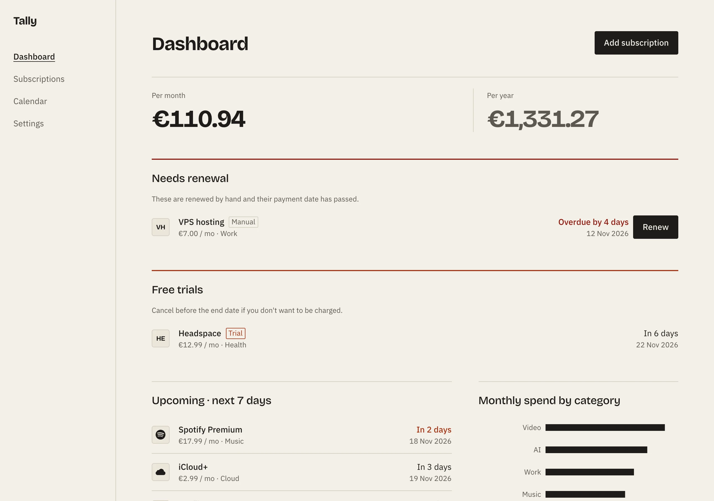
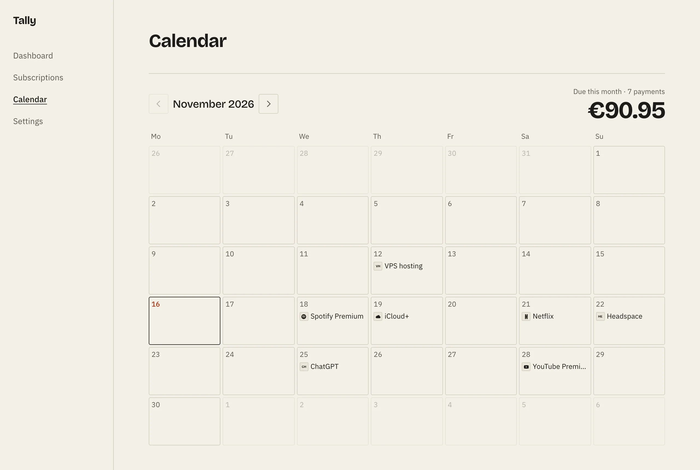
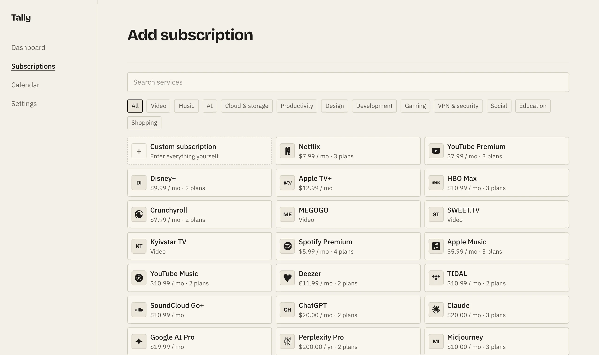

<div align="center">


# Tally

**Subscriptions renew quietly. Tally tells you before they do.**

A small desktop app that keeps the list of everything you pay for — weekly, monthly or yearly —
and reminds you before each charge. Nothing leaves your computer.

</div>

<br>

<p align="center">
  
</p>

## Why

Most of us have found a €9.99 line on a bank statement and couldn't remember signing up.
Tally is a plain list with a date next to every line, a total at the top and a notice before
money goes out. No account, no server, no analytics — the app makes **zero network requests**.

## What it does

|  |  |
| --- | --- |
| **Reminders before every charge** | Native notifications on the day or up to seven days ahead. Close the window and Tally stays in the menu bar (macOS) or system tray (Windows), showing what is due next. |
| **Honest totals** | Weekly, monthly and yearly plans add up to one monthly and one yearly figure in your base currency. You set exchange rates yourself; nothing is guessed. |
| **Quick add** | About fifty popular services — Netflix, Spotify, ChatGPT, iCloud+ and others — with logo, category, typical price and cancel link filled in. Or type your own. |
| **Free trials** | Mark a trial and get a "cancel before…" reminder. When it ends, it becomes a regular subscription. |
| **Manual renewals** | For things you pay by hand, an overdue date stays on the dashboard until you press **Renew**. Every payment is logged. |
| **Calendar** | A month view of every charge and the total due that month. |
| **Backups you own** | Export everything to a JSON file and import it back. Imports are checked in full before anything is replaced. |
| **Your language** | Ukrainian, Russian or English, light or dark. On first launch Tally asks which language you want. |

<table>
  <tr>
    <td width="50%"></td>
    <td width="50%"></td>
  </tr>
  <tr>
    <td align="center"><sub>Payment calendar</sub></td>
    <td align="center"><sub>Adding from the catalog</sub></td>
  </tr>
</table>

## Download

Get the latest version from **[Releases](https://github.com/ssaddist/sub-tracker/releases/latest)**.

| System | File |
| --- | --- |
| macOS (Apple Silicon and Intel) | `Tally_x.y.z_universal.dmg` |
| Windows 10 / 11 | `Tally_x.y.z_x64-setup.exe` |

> [!NOTE]
> The builds are not code-signed yet.
> **macOS:** right-click Tally in Applications → **Open** the first time, or run
> `xattr -dr com.apple.quarantine /Applications/Tally.app`.
> **Windows:** if SmartScreen says "Windows protected your PC", click **More info → Run anyway**.

## Privacy

- Your data lives in a local SQLite database in the app's data folder.
- No account, no sync, no telemetry, no update checks.
- A strict Content Security Policy blocks network access from the interface; service logos are bundled, not downloaded.
- Files are read and written only where you point the system open/save dialog.

## Development

Built with [Tauri 2](https://tauri.app), React 18, TypeScript and SQLite.
You need [Node.js](https://nodejs.org) 22+ and [Rust](https://rustup.rs).

```bash
npm install
npm run tauri dev     # run the desktop app
npm test              # unit tests for the domain logic
npm run typecheck     # TypeScript
npm run tauri build   # installers for the current OS → src-tauri/target/release/bundle
npm run dev           # UI only, in a browser, with in-memory data
```

<details>
<summary><b>Project layout</b></summary>

```
src/
  domain/      pure logic and tests: totals, currency, date rollover, reminders, calendar, backups
  presets/     catalog of popular services (plans, typical prices, cancel links, logos)
  i18n/        Ukrainian, Russian and English dictionaries; plurals, dates, money
  data/        repository interface; SQLite, plus an in-memory fallback for the browser
  services/    notifications, tray, open at login, backup files, links
  state/       app data context: loading, rollover on start, serialised writes
  screens/     dashboard, subscriptions, calendar, form, detail, settings, language picker
  components/  shared UI
  styles/      theme.css — design tokens for light and dark
src-tauri/
  src/lib.rs   tray, window and plugin setup
  migrations/  database schema
  capabilities/default.json  minimal permissions
```

</details>

<details>
<summary><b>How the numbers work</b></summary>

- **Amounts** are stored as integers in minor units (cents; JPY has none).
- **Per month**: weekly × 52 / 12, yearly / 12.
- **Exchange rates** are entered in Settings as "1 XXX = rate base". A subscription in a currency without a rate is left out of totals and flagged.
- **Rollover**: a past payment date moves forward by whole billing periods. Monthly and yearly plans keep their original day, so Jan 31 → Feb 28 → Mar 31 does not drift.
- **Reminders** fire once per payment date for active subscriptions due within your reminder window.
- **Manual renewal**: paying early keeps the schedule; paying late starts the new period on the payment day.
- **Backups**: if a restore fails midway, the previous data is put back.

</details>

## License

[MIT](LICENSE) © 2026 ssaddist. Service logos come from [Simple Icons](https://simpleicons.org) (CC0);
brand names belong to their owners.
